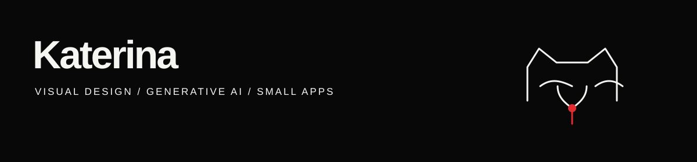
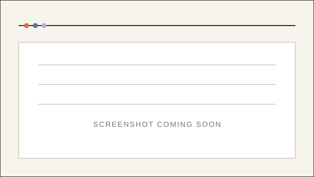
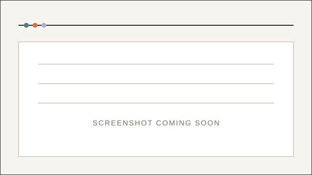
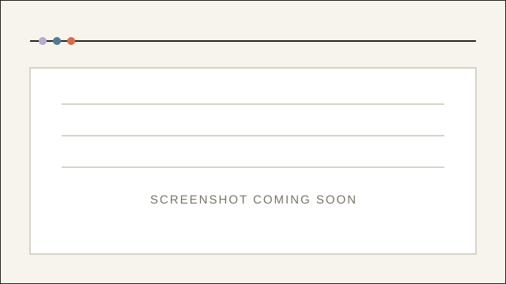

<picture>
  <source media="(prefers-color-scheme: dark)" srcset="assets/profile-banner-dark.svg">
  
</picture>

### Hello, I'm Katerina

I'm learning visual design, experimenting with generative AI, and building small apps with AI coding tools.

I like turning loose ideas into useful, hands-on projects and learning by making.

## Selected projects

<table>
  <tr>
    <td width="33%" valign="top">
      
      <h3>News Digest</h3>
      A personal dashboard for following news and tools in AI visual design.
    </td>
    <td width="33%" valign="top">
      
      <h3>Whisper Studio</h3>
      A local app for audio transcription and turning recordings into notes.
    </td>
    <td width="33%" valign="top">
      
      <h3>VK AI Post Studio</h3>
      A work-in-progress app for planning and managing content for a VK community.
    </td>
  </tr>
</table>

*These are personal projects. Their source code is currently private.*

## Tools

**Design** — Figma 
**AI** — ChatGPT, Codex, DeepSeek, Hermes

## Currently learning

Figma, visual design and web development.
